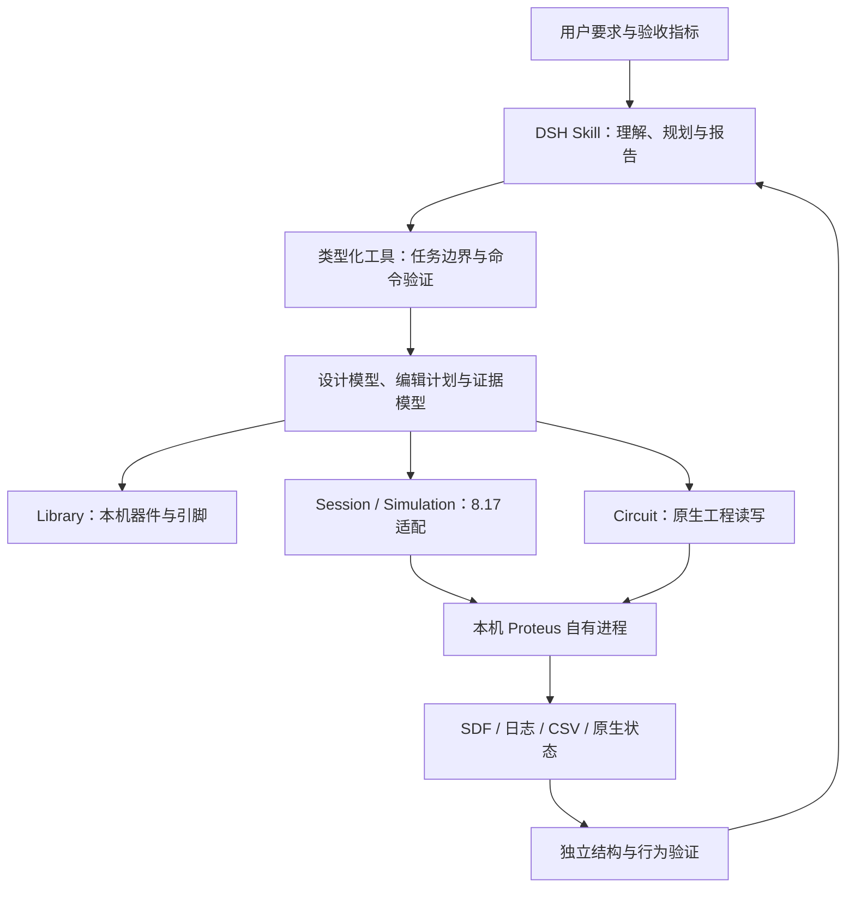

# Proteus 8.17 SP2 通用 Skill：设计思路与架构

设计基线：2026-10-27。目标构建为 Proteus 8.17 SP2 / PDS.EXE 8.17.37159.0。本文在进入本轮实现前建立；实现状态以 [路线与验收](ROADMAP.md) 为准。

## 目标与完成含义

将现有三个课程模板升级为可组合的通用原理图自动化工具链，能力至少对齐教师参考的 `proteus-skills` + `proteus-automatic-api 0.2.0` 已支持范围。用户要求先形成设计思路、规范、路线，再自主实施；本轮已获得在任务副本上进行兼容性研究、开发、安装项目内依赖和真实验证的授权。

“通用”指根据器件、引脚、网络、属性和激励组合出未预置成品模板的电路；现有 divider/cascade/switch 成为配方和回归用例，不再决定工具的全部操作集合。不能通过增加固定 case 或只开放任意 shell 来宣布完成。

本期对齐单用户页、受支持器件/模型、原理图编辑、固件加载、仿真、六类二态输入、GPIO 日志和已有图表的模拟量读取。不宣称覆盖全部 Proteus 格式/器件、多页多单元结构、任意探针/图表创建、任意引脚强制输入、完整 PCB 自动布局布线或所有 Proteus 版本；这些不是参考库已经完成的能力。

## 参考与取舍

| 来源 | 借鉴/采用内容 | 不作的推导 |
| --- | --- | --- |
| [教师 Skill](https://github.com/kudoumakoto6523-design/proteus-skills) | 按任务读取参考、环境准备、公开 API 工作流、结构/运行证据区分 | 演示 GIF 或已存在结果不等于本次任务成功 |
| [参考 Python 库](https://github.com/kudoumakoto6523-design/Proteus_automatic_package/tree/7439819a7ea4cff47fb9b321d8b0e97ac74fafb2) | 合法复用 MIT 原创解析/编辑/测量代码，保留归属；能力和验收逐项对齐 | 8.16 DLL 指纹/内部布局不能直接加 8.17 hash 后视为兼容 |
| [EasyEDA API Skill](https://github.com/easyeda/easyeda-api-skill) | 模块化 API、执行桥接、会话身份、签名/枚举查证、单位明确、按需文档、结果回读 | 不复制 EasyEDA 的器件内容、接口、单位、协议或内部格式，不在本任务操控 EasyEDA |
| [KiCad IPC 设计](https://dev-docs.kicad.org/en/apis-and-binding/ipc-api/) | 类型化消息、文档/会话识别、串行执行、事务/撤销边界、忙状态及有限重试 | 不把 KiCad 的接口存在视为 Proteus 有同样接口；不强行引入相同传输技术 |
| [Agent Skills 规范](https://agentskills.io/specification) | 精确的能力描述、分层披露、按需参考与独立许可 | 文件格式通过不等于行为通过 |
| [Proteus 8.17 官方说明](https://www.labcenter.com/whatsnew/8.17/)及本机 HELP/SAMPLES | 本机构建的 ADI、SDF、器件/仪器参考，RC/STM32 官方样例作私有输入 | 随附文档可能沿用旧内容，8.17 网页的 SP4 功能不自动适用于 SP2 |

本机静态资料已核：ISIS.chm 提供 ADI 属性语言和原生 SDF 说明；Rescap 样例 FILEVER 840/CDB v7，STM32 闪灯样例 FILEVER 841/CDB v7。标记匹配仅是研究线索，不是编辑/运行兼容证明。VSMSDK.chm 仅为 SDK 申请说明，不能当作完整 SDK 已到手。

## 分层结构

### 1. Skill 和类型化工具

Skill 负责将自然语言转成可组合操作、检查前置条件和报告证据。接口按 Library、Circuit、Session、Simulation、Measure、Verify 六域组织；示例配方在其上构建。客户端不能提交任意代码、解释器、模块名、shell 或任意文件路径。

工具先声明任务根、允许输入、输出目录、安装位置、版本和能力状态；模型使用实体/产物 ID 或任务内相对路径。结构编辑可以分步规划并原子提交。仿真事件序列可在一次批处理中保持同一 Session；确有交互需求时用任务级持久 worker，不因参考 Skill 使用 WebSocket 就先开网络服务。

### 2. 统一设计与证据模型

- `DesignSpec`：组件、器件定义来源、引脚、网络/标签/电源、位置/朝向、固件引用、已有图表、待验证要求。
- `EditPlan`：可组合操作和 `expected_revision`，区分新建、编辑及只改属性；每步返回已分配实体和实际状态。
- `CapabilityProfile`：实现是否存在、当前环境探测结果、实测状态、适用构建和限制分别记录，不能合成一个不透明的 supported=true。
- `EvidenceBundle`：请求、源/工程/固件哈希、应用构建、会话身份、操作、原生回读、原始数据与验证结论。观测不取自预期。

公共坐标明确使用毫米或明确标记的原生整数单位，角度/镜像、引脚逻辑名称与数值编号分别建模。Proteus 适配器负责换算；不复用其他 EDA 的坐标常量。引用改名与稳定实体身份不能混淆。

### 3. 原生工程与器件层

优先采用保守的受支持格式解析/序列化及原生 ADI/SDF。新建电路可用合法本机空白工程/器件定义作为格式容器，但拓扑必须由通用操作组合生成。既有工程必须保留已识别结构；未知对象阻止整体重写，不能静默丢弃。

器件发现来自本机安装，不把“目录可查”写成“可导入、可仿真”。所需模型/封装/固件分别验证。引用上游 MIT 实现时，集中放入有版本清单的 vendor 区；自有配置与 8.17 适配保持独立，记录修改，不在运行时修改全局 Python 模块或第三方安装。

### 4. 8.17 会话与运行层

每个会话拥有明确项目、进程及创建时间，所有原生操作串行。格式编辑、原生保存、仿真三个状态不能并发写同一工程；保存关闭后再次文件编辑须重新加载。控件绑定必须保存并重开后使用。

复用已验证的菜单、ADI、SDF 和 PID 操作。涉及内部对象/内存读取时，只允许当前自有 PID，必须有本机构建指纹、对象类型、指针范围及状态的独立检查；缺证据时拒绝，不复制 8.16 偏移或扩大旧白名单后宣布支持。安装目录/DLL/模型/许可证及全局 ACL 不修改。

### 5. 验证层

结构验证比较请求设计与 Proteus 实际 SDF，包括应连接/应隔离的引脚集合、属性和引用。固件验证绑定实际装载文件。运行验证读取实际时间、GPIO 事件和 CSV 样本，检查传播/固件响应；机械位置不代替电气输出。

原课程图像读数保留为已标明方法的特定测量器。达到参考水平所需的通用测量不能只由旧示波器/LED 图像规则代替。请求时间与实测时间分开；未确认时为 false/null，不能冒称定时能力达标。

## 兼容性推进方法

按“实际任务 → 最小失败输入 → 定位格式/库路径/模型/窗口状态/内部对象层 → 独立适配 → 回归 → 继续任务”循环。每个修复保存原因、输入和证据；失败不改写成通过。未知格式的文件写入先离线验证，再原生重开/SDF，最后仿真。能力未通过期间不停止其他可独立推进的模块，也不提前宣布整体完成。

模块/接口/文件应支持替换后端与退出路径。现有 0.1.1 课程功能作为回归基线保留，原始教师资料与官方安装样例不直接修改、不随开源代码分发。
